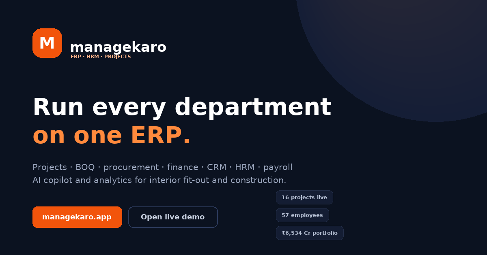

# Managekaro

**ERP + HRM + Project control for interior fit-out and construction companies.**
Projects → BOQ → schedule → DPR → snags → procurement → stores → billing → costing → CRM → HRM → payroll,
with an AI copilot and analytics over the same data — one workspace, every department.



## Quick start

```bash
npm start            # zero-dependency static server → http://localhost:5173
open http://localhost:5173          # marketing site
open http://localhost:5173/app#/dashboard   # the ERP (seeded demo workspace)
open http://localhost:5173/docs     # user manual
open http://localhost:5173/download # Windows app + PDF user book
```

No build step, no framework, no server runtime: `index.html` + `assets/css` + `assets/js`.

## What's inside

| Area | Screens |
|---|---|
| Overview | Command Centre, My Work, Approvals |
| Delivery | Projects (9 tabs), Schedule & Gantt, Daily Progress (DPR), Snags, RFIs, Documents |
| Supply | Procurement (indents → RFQ → PO → GRN → 3-way match), Stores & Inventory |
| Money | Finance & Billing, Costing & Budget |
| Growth | CRM & Leads, Quotations |
| People | HRM, Employees, Attendance, Leave, Payroll, Recruitment, Performance |
| Intelligence | Analytics (6 tabs), AI Copilot, Agents |
| Admin | Assets, Compliance, Masters, Users & Roles, Integrations, Settings, Plan & Billing, Help & Manual |

48 routes, all live against a deterministic demo dataset (16 projects, 57 employees, ~1,200 cost lines).
Reset any time from **Settings → Data & backup**.

## Deliverables

| File | What it is |
|---|---|
| `downloads/Managekaro-Setup-1.0.0.exe` | Native Windows app (x64) — whole ERP embedded, offline, no install |
| `downloads/Managekaro-Setup-1.0.0-x86.exe` | Same for 32-bit Windows |
| `downloads/Managekaro-User-Book-1.0.pdf` | 36-page user book: 14 chapters, 71 topics, 16 figures |
| `brand/` | Logo set, app icon, social card, `Managekaro-Colours.csv`, `Managekaro-Brand-Guide.csv` |
| `assets/img/shots/` | The product figures used in the manual and the PDF |

## Deploy to Vercel

Import the repository, framework preset **Other**, root directory `.` — `vercel.json` already handles
clean URLs (`/app`, `/docs`, `/login`, `/download`), cache and security headers. Any static host works too.

## Development

```bash
node tools/smoke.js                # headless boot + 48 routes + interactions (needs jsdom)
node tools/desktop/build.js        # rebuild the Windows installers (needs Zig)
node tools/manual/extract.js       # pull live data out of the app for docs
python3 tools/manual/render.py     # redraw the manual figures
python3 tools/manual/book.py       # rebuild the PDF user book
```

`tools/smoke.js` needs jsdom: `npm install --prefix /tmp/domtest jsdom`.
`tools/desktop/build.js` needs Zig at `$ZIG` (default `/tmp/zigpkg/ziglang/zig`).

## Architecture

```
index.html                 single entry, hash router
assets/css/app.css         ERP design system
assets/css/marketing.css   public site, auth, download, docs
assets/js/core/            util · icons · seed · store · ui · marketing
assets/js/modules/         dashboard projects schedule procurement finance crm hrm
                           intelligence admin help manual
assets/js/app.js           boot
```

`MK.store` is the only data boundary — swap it for an API and every screen keeps working.
Data is persisted to `localStorage` (`managekaro.db.v15`).

## License

UNLICENSED — demo and evaluation build.
